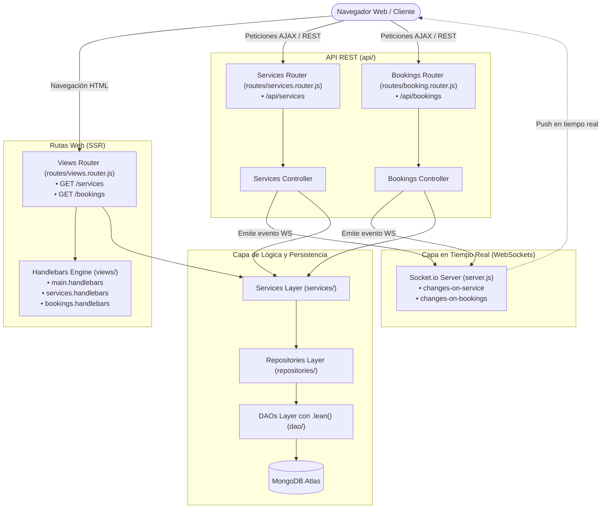

# 7-turnos-BE - Sistema de Gestión de Turnos (Handlebars SSR y WebSockets con Socket.io)

Séptima iteración del backend para la gestión de turnos y servicios. En este proyecto se incorporan **Vistas Dinámicas del lado del servidor (SSR)** utilizando el motor de plantillas **Handlebars**, comunicación bidireccional en tiempo real con **WebSockets (Socket.io)** y se reestructuran los prefijos de las rutas separando la API REST (`/api/...`) de las vistas web (`/...`).

---

## 📋 Descripción y Nuevas Actualizaciones

En comparación con `6-turnos-BE`, esta versión amplía la solución hacia el frontend integrado y la reactividad en tiempo real:

1. **Renderizado del lado del Servidor (SSR) con Handlebars (`express-handlebars`)**:
   - Se configura el motor de plantillas en `src/app.js` con el layout base `src/views/layouts/main.handlebars`.
   - Nuevas vistas dinámicas:
     - `src/views/services.handlebars`: Renderiza el catálogo de servicios en cards visuales.
     - `src/views/bookings.handlebars`: Renderiza el listado de reservas con sus servicios asociados.
   - Enrutador de vistas `src/routes/views.router.js` expuesto en:
     - `GET /services`
     - `GET /bookings`
   - Incorporación de `.lean()` en `ServicesDAO.getAll()` y `BookingsDAO.getAll()` para obtener objetos JSON planos compatibles con las restricciones de prototipo de Handlebars.
2. **Comunicación en Tiempo Real con WebSockets (`socket.io`)**:
   - Se monta una instancia de `Server` de `socket.io` sobre el servidor HTTP en `src/server.js`.
   - **Emisión reactiva desde los controladores**:
     - Al crear, editar o eliminar un servicio, `services.controller.js` emite el evento `"changes-on-service"`.
     - Al crear o actualizar un turno, `bookings.controller.js` emite el evento `"changes-on-bookings"`.
   - **Consumo en el cliente (`src/public/js/`)**:
     - Los clientes conectados a las vistas detectan los cambios vía WebSocket y ofrecen recargar la página inmediatamente para reflejar las novedades sin necesidad de polling.
3. **Servidor de Archivos Estáticos (`src/public/`)**:
   - Servido a través de `express.static(__dirname + "/public")`.
   - Incluye hojas de estilo (`css/index.css`) y scripts cliente para la conexión a sockets (`js/services.js`, `js/bookings.js`).
4. **Reestructuración de Rutas API (`/api/`)**:
   - Para evitar conflictos de enrutamiento con las vistas web, los endpoints de la API REST ahora cuentan con el prefijo `/api`:
     - `/api/services` (reemplaza a `/services`)
     - `/api/bookings` (reemplaza a `/bookings`)

---

## 🏛️ Arquitectura General del Sistema



---

## 🛠️ Requisitos Previos

- **Node.js** (versión 18 o superior)
- **npm**
- Una instancia de **MongoDB** activa (local o MongoDB Atlas)

---

## ⚙️ Variables de Entorno

Configura el archivo `.env` en la raíz de `7-turnos-BE` a partir de `.env.example`:

```env
PORT=8080
NODE_ENV=development
MONGO_DB_URI=mongodb+srv://<usuario>:<password>@<cluster>.mongodb.net/<nombre-bd>
```

| Variable | Tipo | Obligatoria | Descripción |
| :--- | :--- | :--- | :--- |
| `PORT` | Number | Sí | Puerto donde escucha el servidor |
| `NODE_ENV` | String | Sí | Modo de entorno (`development` / `production`) |
| `MONGO_DB_URI` | String | Sí | String de conexión a MongoDB |

---

## 📦 Cómo Instalar

1. Navega al directorio del proyecto:
   ```bash
   cd 7-turnos-BE
   ```

2. Instala las dependencias (incluye `express-handlebars`, `socket.io`, `mongoose`, etc.):
   ```bash
   npm install
   ```

3. Crea y verifica el archivo `.env`:
   ```bash
   cp .env.example .env
   ```
   *(En PowerShell: `Copy-Item .env.example .env`)*

---

## 🚀 Cómo Ejecutar

- **Modo Desarrollo** (recarga en caliente de archivos JS y Handlebars):
  ```bash
  npm run dev
  ```

- **Modo Producción**:
  ```bash
  npm start
  ```

Salida esperada en terminal:
```text
Conexion con la base de datos exitosa
Servidor HTTP en http://localhost:8080 (development)
```

---

## 📁 Estructura del Proyecto

```text
7-turnos-BE/
├── .env.example
├── package.json
├── src/
│   ├── app.js                          # Configuración de Express, Handlebars y estáticos
│   ├── server.js                       # HTTP server + Socket.io + Conexión MongoDB
│   ├── utils.js                        # Helper __dirname para ES Modules
│   ├── config/
│   │   ├── database.config.js          # Conexión Mongoose
│   │   └── env.config.js               # Validación de variables de entorno
│   ├── controllers/                    # Controladores con emisión de eventos Socket.io
│   │   ├── bookings.controller.js
│   │   └── services.controller.js
│   ├── services/                       # Lógica de negocio
│   │   ├── bookings.service.js
│   │   └── services.service.js
│   ├── repositories/                   # Repositorios
│   │   ├── bookings.repository.js
│   │   └── services.repository.js
│   ├── dao/                            # DAOs Mongoose (con .lean() para Handlebars)
│   │   ├── bookings.dao.js
│   │   └── services.dao.js
│   ├── models/                         # Modelos Mongoose
│   │   ├── bookings.model.js
│   │   └── services.model.js
│   ├── public/                         # [NUEVO] Archivos estáticos y scripts cliente
│   │   ├── css/
│   │   │   └── index.css
│   │   └── js/
│   │       ├── bookings.js             # Escucha de WebSockets en vista de reservas
│   │       └── services.js             # Escucha de WebSockets en vista de servicios
│   ├── routes/                         # Enrutadores
│   │   ├── booking.router.js           # API REST: /api/bookings
│   │   ├── services.router.js          # API REST: /api/services
│   │   └── views.router.js             # [NUEVO] Vistas SSR: /services y /bookings
│   ├── views/                          # [NUEVO] Plantillas Handlebars
│   │   ├── bookings.handlebars
│   │   ├── services.handlebars
│   │   └── layouts/
│   │       └── main.handlebars
│   └── utils/
│       └── http.js
```

---

## 🖥️ Vistas Frontend (SSR)

Ingresa desde cualquier navegador a:

- `http://localhost:8080/services`: Visualiza en tiempo real el catálogo de servicios en tarjetas.
- `http://localhost:8080/bookings`: Visualiza en tiempo real los turnos reservados, datos del cliente y lista de servicios asociados.

> [!TIP]
> Si abres dos pestañas en el navegador (una en la vista `/services` y otra usando Postman/cURL para crear un servicio en `/api/services`), verás cómo el cliente Socket.io alerta instantáneamente sobre los cambios detectados sin refrescar manualmente.

---

## 🔌 API REST y Ejemplos de Uso

> [!IMPORTANT]
> Recuerda que todas las rutas de la API ahora utilizan el prefijo **/api/**.

### Servicios (`/api/services`)

#### 1. Obtener todos los servicios
```bash
curl -X GET http://localhost:8080/api/services
```

**Respuesta Exitosa (200 OK):**
```json
{
  "status": "success",
  "payload": [
    {
      "_id": "664f1a23e59b1a03f491c011",
      "name": "Corte y Peinado",
      "description": "Lavado, corte personalizado y peinado",
      "duration": 45,
      "price": 11000,
      "category": "Peluquería",
      "available": true
    }
  ]
}
```

---

#### 2. Obtener servicio por ID (`:sid`)
```bash
curl -X GET http://localhost:8080/api/services/664f1a23e59b1a03f491c011
```

---

#### 3. Crear nuevo servicio (Emite `changes-on-service`)
```bash
curl -X POST http://localhost:8080/api/services \
  -H "Content-Type: application/json" \
  -d '{
    "name": "Coloración y Mechas",
    "description": "Técnica balayage con nutrición",
    "duration": 120,
    "price": 38000,
    "category": "Peluquería",
    "available": true
  }'
```

---

#### 4. Actualizar servicio (`:sid`) (Emite `changes-on-service`)
```bash
curl -X PUT http://localhost:8080/api/services/664f1a23e59b1a03f491c011 \
  -H "Content-Type: application/json" \
  -d '{
    "price": 12500
  }'
```

---

#### 5. Eliminar servicio (`:sid`) (Emite `changes-on-service`)
```bash
curl -X DELETE http://localhost:8080/api/services/664f1a23e59b1a03f491c011
```

---

### Reservas (`/api/bookings`)

#### 1. Obtener reserva por ID (`:bid`)
```bash
curl -X GET http://localhost:8080/api/bookings/664f22abe59b1a03f491c025
```

---

#### 2. Crear una reserva (Emite `changes-on-bookings`)
```bash
curl -X POST http://localhost:8080/api/bookings \
  -H "Content-Type: application/json" \
  -d '{
    "clientName": "Ana Morales",
    "clientEmail": "ana.morales@example.com",
    "date": "2026-12-10",
    "time": "18:00",
    "status": "confirmed",
    "services": [
      {
        "service": "664f1a23e59b1a03f491c011",
        "quantity": 1
      }
    ]
  }'
```

---

#### 3. Agregar o incrementar un servicio en una reserva (Emite `changes-on-bookings`)
```bash
curl -X POST http://localhost:8080/api/bookings/664f22abe59b1a03f491c025/services/664f1a23e59b1a03f491c011
```

